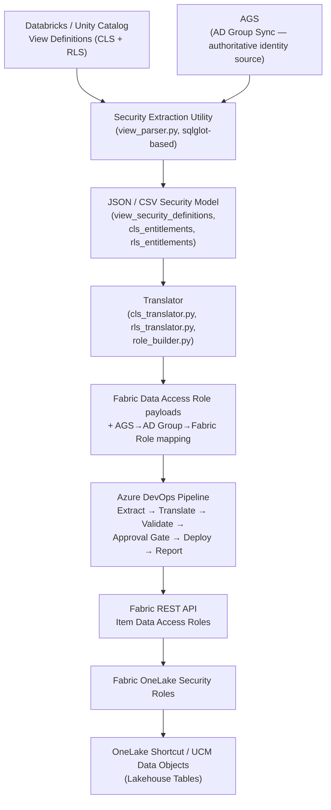
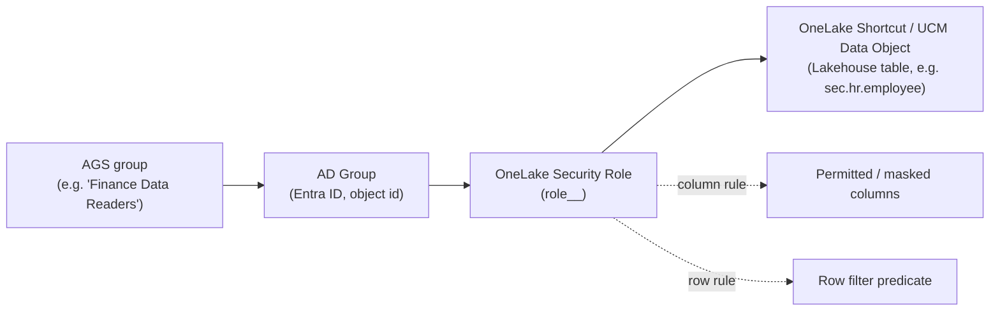

# Architecture

## End-to-end pipeline

## Security role mapping (scope item 3)

Group membership management, role creation, and the relationship between
Fabric roles and OneLake objects are all driven from the same extraction
output: one Fabric role is created per **(table, AD group)** pair found in
the Databricks view definitions, carrying whatever column and row rules
were derived for that pairing. AGS remains authoritative for group
membership; this toolkit never creates, edits, or deletes AD groups or AGS
records -- it only reads the AGS export to resolve group names to Entra
object ids for role `members` payloads.

## Component responsibilities

| Component | Responsibility | Source |
|---|---|---|
| Security Extraction Utility | Parse Databricks view DDL, extract column lineage, CLS masks, RLS predicates, and flag unsupported constructs | `src/dbx_fabric_security/extractor/` |
| Translator | Convert extracted constructs into Fabric-shaped CLS/RLS entitlements and merged Data Access Role payloads | `src/dbx_fabric_security/translator/` |
| Role Mapper | Join AGS export data to generated roles for the AGS → AD Group → Fabric Role → OneLake object report | `src/dbx_fabric_security/mapping/` |
| Fabric API Client | Thin REST wrapper (dry-run by default) around the Fabric Item Data Access Roles API | `src/dbx_fabric_security/fabric_api/` |
| CLI | Orchestrates extract → translate → map-roles → deploy as a single command or discrete steps | `src/dbx_fabric_security/cli.py` |
| Azure DevOps Pipeline | Runs the CLI stages with a manual approval gate before any live deploy | `pipelines/azure-pipelines-security-migration.yml` |
