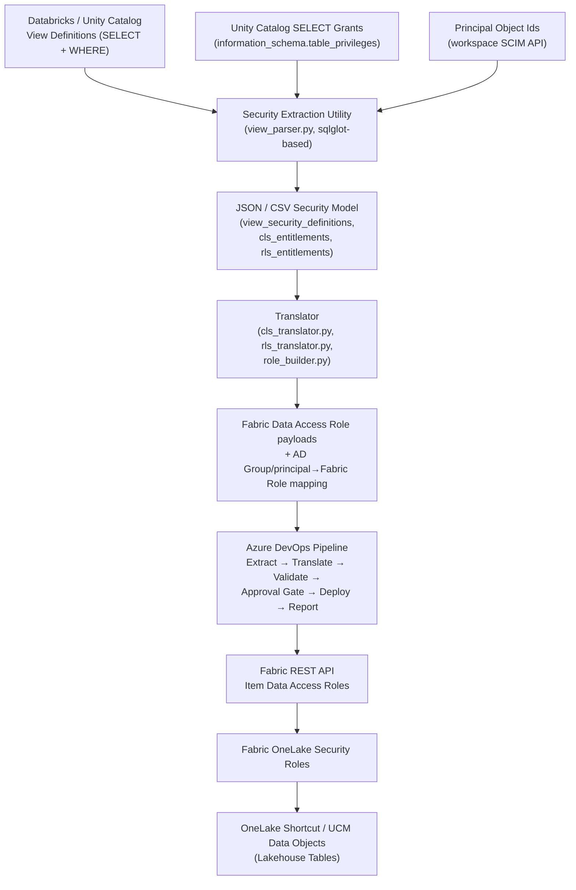
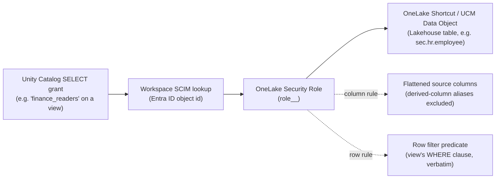
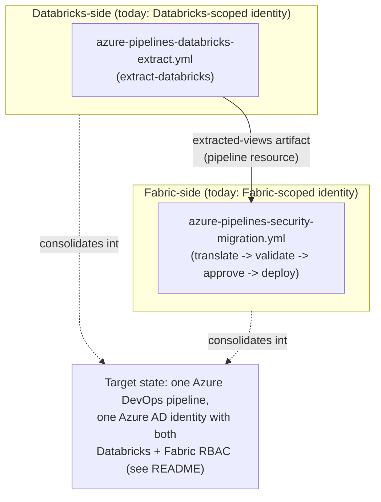

# Architecture

## End-to-end pipeline

Access (who) and shape (what data) are extracted as two independent
inputs and joined by view name — a view's grantees come from Unity
Catalog's actual `SELECT` grants, never from parsing its SQL; the SQL is
only used to work out which physical columns and which row predicate that
grant covers. See `docs/technical-assessment.md` §1 for why this replaced
an earlier SQL-pattern-matching approach.

## Security role mapping (scope item 3)

Role creation and the relationship between Fabric roles and OneLake objects
are driven entirely from the same extraction output: one Fabric role is
created per **(table, principal)** pair found in the Databricks view
definitions, carrying whatever column list and row filter were derived for
that pairing. There is no separate identity-mapping step or external
export in the loop -- the principal's Entra object id is resolved once,
directly from Databricks (via SCIM), at extraction time, and flows straight
through to the role's `members` payload.

## Pipeline split (interim) vs. target state

Today the two pipelines run under separate identities/service connections so
each side can be permissioned minimally and independently (see README.md,
"RBAC / permissions required"). Neither the extraction code nor the
translate/deploy code changes to support the target state -- consolidating
onto one Azure AD application that holds both sets of grants, and one
pipeline (or one pipeline with two stages using that identity), is purely a
credentials/pipeline-wiring change.

## Component responsibilities

| Component | Responsibility | Source |
|---|---|---|
| Security Extraction Utility | Parse Databricks view DDL (flattened columns, verbatim WHERE clause), read Unity Catalog SELECT grants, and flag unsupported constructs | `src/dbx_fabric_security/extractor/` |
| Translator | Cross-product grantees × flattened columns (CLS) and grantees × WHERE clause (RLS) into Fabric-shaped entitlements and merged Data Access Role payloads | `src/dbx_fabric_security/translator/` |
| Role Mapper | Flatten generated roles into the AD Group/principal → Fabric Role → OneLake object report | `src/dbx_fabric_security/mapping/` |
| Fabric API Client | Thin REST wrapper (dry-run by default) around the Fabric Item Data Access Roles API | `src/dbx_fabric_security/fabric_api/` |
| CLI | Orchestrates extract → translate → map-roles → deploy as a single command or discrete steps | `src/dbx_fabric_security/cli.py` |
| Azure DevOps Pipeline | Runs the CLI stages with a manual approval gate before any live deploy | `pipelines/azure-pipelines-security-migration.yml` |
